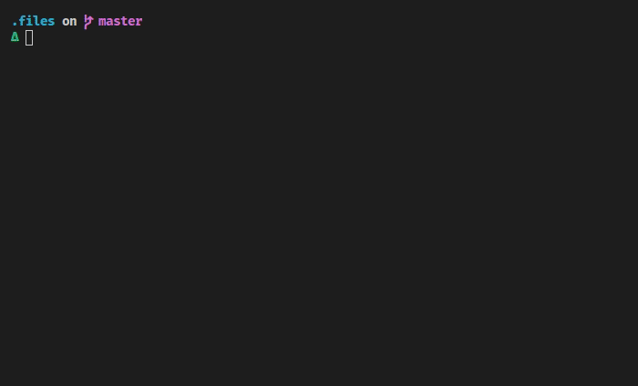

<div align="center">
  
  
  
</div>

<h1 align="center">
  <strong>.files</strong>
</h1>

`.files` will sanely setup a machine, and provide quality of life improvements.

These are one person's dotfiles: a bash bootstrapper (`bootstrap.sh`) that installs and links a
chosen set of **modules** (shell, git, language toolchains, coding-agent config, package-install
guards) on macOS or Ubuntu, so a new machine or server reaches the author's working setup in one
command. The repo exists to make that setup reproducible across the author's own machines; it is
not packaged for general use, and several modules assume the author's accounts and machines.
**Status: active.** Started in September 2019, 875 commits, 34 of them in the month to
2026-10-15 (from `git log`).

### Key takeaways

- **One command sets up a machine.** `./bootstrap.sh --cli --yes` installs a fixed server
  profile of 14 named modules plus their dependencies; `./bootstrap.sh` asks module by module.
  See [Installation](#gear-installation). [confidence: ~80% on a current macOS or Ubuntu LTS,
  resting on the author's ongoing use and the platform-specific installers, not on a
  clean-machine test; lower for the oldest versions the code accepts]
- **Install order is derived, not hand-maintained.** Each module declares its needs in
  `deps.conf`; the bootstrapper topologically sorts them and aborts on a cycle or unknown name.
  See [Dependencies](#dependencies). [confidence: ~90%; `tests/module-deps.test.sh` passes]
- **The risky parts are guarded by test suites that run only at commit time.** Symlink pruning,
  the daily auto-update, the package-install firewall and release-age gate, and three of the
  agent hooks (the scancel guard, `/note` and the response gate) each have a suite wired into the
  pre-commit hooks; the other agent hooks do not, and there is no test CI. See
  [What is verified](#what-is-verified). [confidence: ~90% that the hooked suites pass at the
  audited commit; they cover only the cases they test]
- **Part of the repo is encrypted and unreadable in a public clone.** Sensitive files are
  encrypted at rest with [glassine](https://github.com/DJRHails/glassine); without the key those
  paths stay ciphertext, so the modules that use them will not work for you. See
  [Scope and limitations](#scope-and-limitations).
- **Borrow ideas, don't install wholesale.** Modules such as `ssh`, `onepassword` and `claude`
  are written for the author's own machines and accounts. See
  [Scope and limitations](#scope-and-limitations).

What the value rests on: the module model plus the dependency resolver in `bootstrap.sh`, and
the commit-time test suites that guard the modules which delete files, rewrite config unattended
or gate package installs. If those suites stopped running, nothing else would catch a regression.

Confidence tags are an assessment of the evidence in this repo (test runs, code paths, git history),
added in a 2026-10 README audit; they are not new measurements. For a tooling repo like this
one, "evidence" means test runs, code paths and commit history rather than samples or seeds.

**Contents:** [Installation](#gear-installation) · [Modules](#package-modules) ·
[Dependencies](#dependencies) · [What is verified](#what-is-verified) ·
[Scope and limitations](#scope-and-limitations) · [History and provenance](#history-and-provenance)
· [Inspired by](#zap-inspired-by)

## :gear: Installation
```bash
git clone --recurse-submodules https://github.com/DJRHails/dotfiles.git ~/.files
cd ~/.files
./bootstrap.sh --cli --yes

# Custom config
./bootstrap.sh
```

<div align="center">



</div>

Flags (from `./bootstrap.sh --help`):

| Flag          | Effect
| ------------- | ------
| `-c, --cli`   | Server profile: `zsh`, `ssh`, `git`, `python`, `node`, `piknik`, `tailscale`, `cloudflared`, `cloudflare`, `claude`, `agents`, `sfw`, `release-age`, `dotfiles-autoupdate`, plus whatever their `deps.conf` pulls in.
| `-y, --yes`   | Skip interactive questions (does not select every module).
| `-A, --all`   | Run every directory under `modules/`.
| `<modules>…`  | Install the named modules, e.g. `./bootstrap.sh git zsh`.

For each selected module the bootstrapper creates the links in `symlinks.conf` (and
`symlinks.<os>.conf`), then runs `install.sh`, `install.<os>.sh`, `setup.sh` and
`setup.<os>.sh` where present. `scripts/core/platform.sh` accepts macOS 10.10+ and Ubuntu 18.04+;
those are the gates in the code, and this audit found no record of testing at those versions.
The `Dockerfile` runs
`./bootstrap.sh --cli --yes` on Ubuntu 24.04 as a clean-machine check
(`docker build -t dotfiles .`); it is not run by CI, and this audit did not run it.

## :package: Modules

| Module                  | Description
| ----------------------- | -----------
| :sparkle: `agents`      | Shared coding-agent config — AGENTS.md, skills, commands, and subagents, symlinked into each agent's config dir.
| `alwayson`              | Keep a macOS machine awake (pmset, with backup/restore).
| `askllm`                | Ask an LLM from the terminal (git submodule behind `bin/askllm`).
| `ci-runners`            | Self-hosted GitHub Actions runner pools, declared in `runners.conf` and reconciled by `provision.sh` (run by hand; no installer, so `bootstrap.sh` skips it).
| :sparkle: `claude`      | Claude Code setup — settings, guardrail hooks, MCP servers, statusline.
| `cloudflare`            | Cloudflare's unified `cf` CLI (DNS, zones, R2, …), authenticated by a long-lived API token in the module's gitignored `.env`.
| `cloudflared`           | Cloudflare Tunnel client via signed apt repo.
| `code`                  | VS Code settings.
| `codex`                 | Codex CLI configuration.
| `docker`                | Docker runtime via Colima (macOS) or Docker Engine (Linux).
| `dotfiles-autoupdate`   | Once-daily, fast-forward-only pull of `~/.files` (launchd, systemd timer or cron); carries local changes on a stash and never pushes.
| `execblock`             | Execute code blocks from markdown files (`bin/execblock`).
| `explaincron`           | Explain crontab entries (`bin/explaincron`).
| `gdrive`                | Google Drive mount via ocamlfuse.
| `ghostty`               | Ghostty terminal config.
| :sparkle: `git`         | Git aliases, user-level config, and GitHub ssh/gpg onboarding.
| `go`                    | Go toolchain: brew where available, else the go.dev tarball into `~/.local/go`.
| `gpu-vm`                | On-demand cloud GPU pods over ssh, with cron-based idle reaping.
| `keybase`               | Keybase client.
| `node`                  | Node.js via NodeSource signed repo.
| `onepassword`           | 1Password app + `op` CLI, and the SSH agent config naming which vaults offer keys.
| `pentest`               | Aliases useful in penetration tests / deobfuscation.
| `pi`                    | pi coding agent config.
| `piknik`                | Cross-machine clipboard.
| `python`                | python3, uv, and virtualenv quality-of-life aliases.
| `raycast`               | Raycast (macOS launcher).
| `release-age`           | 7-day minimum release age for npm/pnpm/bun/uv/pip/cargo — a compromised release gets a week to be caught before it can install here.
| `rust`                  | Rust toolchain via rustup, plus cargo tools.
| `sfw`                   | Socket Firewall — blocks known-malicious packages on npm/pnpm/yarn/pip/uv/cargo installs.
| `slurm`                 | Slurm helper aliases for GPU clusters.
| `spend-watch`           | Daily digest of GitHub metered spend, posted to Slack (no installer; added to cron by hand, see its README).
| :sparkle: `ssh`         | ssh config template for commonly used machines.
| `tailscale`             | Tailscale VPN (exit-node advertising is opt-in).
| `tesseract`             | OCR via tesseract + imagemagick (`bin/ocr`).
| `vim`                   | vim & vim config.
| `zellij`                | Zellij terminal multiplexer with durable remote sessions.
| :sparkle: `zsh`         | zsh, aliases, completion, and the glue that loads every module's `*.zsh`.

### Dependencies

A module declares what it needs in its own `deps.conf` — one module name per
line, `#` comments and blank lines ignored:

```bash
# modules/claude/deps.conf
# install.sh installs `ant` with install::go_tool, which needs the go toolchain.
go
```

`bootstrap.sh` resolves those declarations before installing anything:
dependencies are pulled in even when you didn't select them (`./bootstrap.sh
claude` also installs `go`), and the install order is topologically sorted so a
module always runs after everything it depends on. Modules with no dependency
relationship keep the order you asked for.

Resolution failures abort the run rather than degrade — a dependency naming a
module that doesn't exist, or a cycle:

```
   [✖] module dependencies cannot be resolved (cycle detected)
   [✖]   claude -> go -> claude
   [✖]   unresolvable modules: claude go
```

Current edges:

| Module       | Needs           | Why
| ------------ | --------------- | ---
| `agents`     | `python`        | `skills/` ships `uv run` and `python3` entrypoints.
| `claude`     | `go`            | `install.sh` installs `ant` with `install::go_tool`.
| `claude`     | `node`          | `mcp.json` launches playwriter and context7 with `npx`.
| `claude`     | `python`        | `settings.json` registers `python3 .../hooks/*.py` hooks (three scripts, five entries).
| `cloudflare` | `node`          | `install.sh` installs the `cf` CLI with `npm install -g`.
| `execblock`  | `python`        | `bin/execblock` runs `uv run`.
| `explaincron`| `python`        | `bin/explaincron` builds its venv with `python3 -m venv`.
| `git`        | `rust`          | `setup.sh` seeds `~/.git-template` with `prek`, a cargo tool.
| `git`        | `ssh`           | `setup.github.sh` appends to `~/.ssh/config`, a symlink the ssh module owns.
| `gpu-vm`     | `ssh`           | The `Host gpu*` stanzas live in `modules/ssh/config.tmpl`.
| `pi`         | `node`          | `install.sh` uses `npm install -g`.
| `python`     | `git`           | `install.sh` writes `init.templateDir` into `~/.gitconfig.local`.
| `release-age`| `node`          | `setup.sh` writes the age into npm's and pnpm's user config with their own `config set`.
| `zellij`     | `python`        | `install.*.sh` installs `humane` with `uv tool install`.

Shipping a `*.zsh` fragment is deliberately **not** an edge: `zshrc` globs
`$DOTFILES/modules/*/*.zsh` over the repo tree at shell startup, so nothing is
resolved at install time and 14 identical `→ zsh` edges would make `zsh` a
mandatory graph root that buries the real ordering constraints.

Run `bash tests/module-deps.test.sh` to check the graph still resolves.

## What is verified

There is no test CI. The one workflow, `.github/workflows/bump-graph-design.yml`, only moves the
`graph-design` submodule pin. Verification happens at commit time, through two hook configs that
mirror each other: `.pre-commit-config.yaml` (run with `prek` or `pre-commit`) and `lefthook.yml`
(for clones that use a global lefthook shim). They run:

- secret scanners (`gitleaks`, `trufflehog`; `.pre-commit-config.yaml` only);
- `scripts/check-crypt-patterns.sh` and `glassine check`, which refuse a commit whose encryption
  rules don't match the tracked files or whose encrypted paths are staged as plaintext;
- `scripts/check-dockerignore-crypt.sh`, which refuses a commit when an encrypted file is not
  excluded from the docker build context (`.dockerignore`);
- 13 behaviour suites under `tests/` for the parts whose failure is quiet or destructive:
  the `.dockerignore` encryption check (`dockerignore-crypt`), symlink pruning
  (`link-symlinks`), the daily auto-update (`dotfiles-autoupdate`), the
  package-install firewall and release-age gate (`sfw-aliases`, `release-age`), the Slurm
  cancel guard (`block_unscoped_scancel_test.py`, `scancel-mine`), the CI credential helper,
  `mdunwrap`, `prose-lint`, the `/note` and response-gate agent hooks (`note-hook`,
  `response-gate`), and the `claude::resume` resolver (`claude-resume`).
  `lefthook.yml` runs 11 of the 13.

The other 8 suites in `tests/` (including `module-deps`) are in neither hook config; run them by
hand.

Audit check, 2026-10-17: all 20 files in `tests/` were run on Ubuntu with bash, zsh and
python3. 19 passed (`clean_empty_surfaces_test.py` needs `pytest`, e.g.
`uv run --with pytest python -m pytest -q tests/clean_empty_surfaces_test.py`).
`tests/slurm-job-scoping.test.zsh` failed 1 of its 31 checks: it expects the error text
"could not determine the cluster user" where `bin/scancel-mine` now prints "could not resolve the
cluster user". That suite is not in either hook config, which is how the drift went unnoticed.

To run the hooked checks yourself:

```bash
prek run --all-files                     # or: pre-commit run --all-files
bash tests/module-deps.test.sh           # one of the unhooked suites
```

What the suites do *not* show: that a full `bootstrap.sh` run succeeds on a clean machine. That
rests on the author's own use across their machines (see
[History and provenance](#history-and-provenance)) and on the `Dockerfile` check when someone
runs it.

## Scope and limitations

- It is personal, not general-purpose. `ssh/config.tmpl` names the author's machines,
  `onepassword` names their vaults, and `claude`/`agents` install their agent guardrails and
  skills into your agent config directories. Running `--all` on your machine would install
  config meant for someone else. Read a module before running it.
- Some paths are encrypted. Files matching the `filter=glassine` rules in `.gitattributes` are sops
  envelopes in git (setup notes in `docs/glassine-migration.md`). A clone without a recipient key
  sees ciphertext there, so the skills and config that live in those paths are unusable outside
  the author's machines; history from before the glassine migration is transcrypt ciphertext.
- Only macOS and Ubuntu are recognised; other Linux distributions fail the platform check.
  Within those, coverage varies by module: some ship an installer for one OS only (`alwayson`
  and `raycast` have only `install.macos.sh`); check for `install.<os>.sh`.
- There is no clean-machine test in CI. The most important missing piece is an automated
  end-to-end `bootstrap.sh` run; the `Dockerfile` would provide one for the `--cli` profile on
  Ubuntu if it were wired into CI.
- Some modules fetch the latest release or a vendor install script at install time (`go`,
  `python`, `zsh`, `sfw`, and `tailscale` on Ubuntu; `go`, for example, resolves the newest
  version from go.dev), so two runs a month apart can install different versions. The
  `release-age` and `sfw` modules reduce supply-chain risk for package managers; they do not pin
  these direct downloads.

## History and provenance

Started in September 2019; the dotfiles it credits are listed under
[Inspired by](#zap-inspired-by). Activity by year from `git log`: 55 commits in 2019, 121 in
2020, between 7 and 41 a year from 2022 to 2025, and 604 in 2026, when the coding-agent modules
(`agents`, `claude`, `pi`, `codex`), the dependency resolver and all 20 test suites arrived.
Changes have gone through squash-merged PRs since February 2026 (82 of the last 100 commits carry
a PR number). Encryption at rest moved from transcrypt to glassine on 2026-07-23
(`docs/glassine-migration.md`).

How this README was checked: the module table was compared against `ls modules/`, the flag table
against `bootstrap.sh --help`, the dependency table against every `modules/*/deps.conf`, and the
test claims against a local run of `tests/`. The claim that bootstrap works on current macOS and
Ubuntu comes from the code paths and commit history, not from a clean-machine run.

## :zap: Inspired by
- [@holman](https://github.com/holman/dotfiles)
- [@alrra](https://github.com/alrra/dotfiles)
- [@denisdoro](https://github.com/denisidoro/dotfiles)
